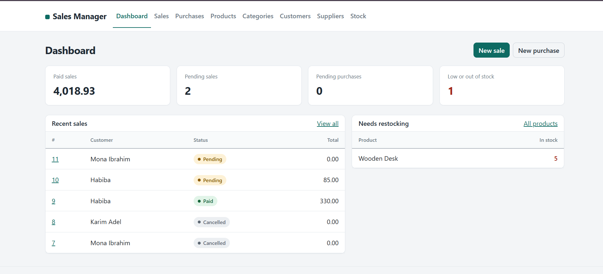

# SalesManagement

A sales and inventory management web app built with **ASP.NET Core Razor Pages** and **Entity Framework Core**, backed by **SQL Server**.

## Features

- **Categories**: create, view, and manage product categories
- **Products**: add and manage products and their details
- **Customers**: add, edit, and list customers
- **Suppliers**: manage supplier records
- **Purchase invoices**: record purchases from suppliers, with line items and history
- **Sales invoices**: record sales to customers, with line items and history
- **Stock tracking**: stock history updated as purchases and sales happen

## Tech Stack

| Layer | Technology |
|-------|------------|
| Framework | ASP.NET Core Razor Pages |
| Language | C# |
| ORM | Entity Framework Core |
| Database | Microsoft SQL Server |
| IDE | Visual Studio 2022 |

## Project Structure

```
SalesManagement/
├── Extensions/     # Extension methods (e.g. DatabaseExtension.cs)
├── Models/         # Entity classes and SalesManagementDbContext
├── Pages/          # Razor Pages (Categories, Customers, Products, ...)
├── wwwroot/        # Static files (CSS, JS, images)
├── appsettings.json
└── Program.cs
```

## Getting Started

### Prerequisites

- [.NET SDK](https://dotnet.microsoft.com/download) (the version this project targets)
- [SQL Server](https://www.microsoft.com/sql-server) (Express or LocalDB works fine)
- Visual Studio 2022 or VS Code (optional)

### Installation

1. **Clone the repository**

   ```bash
   git clone https://github.com/habibarezq/SalesManagement-RazorPages.git
   cd SalesManagement-RazorPages
   ```

2. **Configure the database connection**

   Open `appsettings.json` and adjust the connection string if your SQL Server instance is not `localhost`:

   ```json
   "ConnectionStrings": {
     "DefaultConnection": "Server=localhost;Database=SalesManagementDB;Trusted_Connection=True;TrustServerCertificate=True;"
   }
   ```

3. **Create the database**

   If the project includes EF Core migrations:

   ```bash
   dotnet ef database update
   ```

   If `dotnet ef` is not installed: `dotnet tool install --global dotnet-ef`

4. **Run the app**

   ```bash
   dotnet run
   ```

   Then open the URL shown in the terminal (usually `https://localhost:5001` or similar).

   In Visual Studio, press **F5** or click the green **https** button.

## Screenshots

_Add screenshots of your app here, for example:_

```markdown

```

## Roadmap

- [ ] Authentication and user roles
- [ ] Reports and dashboards
- [ ] Search, filtering, and pagination
- [ ] Export invoices to PDF

## Author

**Habiba Rezq**
GitHub: [@habibarezq](https://github.com/habibarezq)

## License

This project is open source. Add a license of your choice (for example MIT) via **Add file → Create new file → LICENSE** on GitHub.
